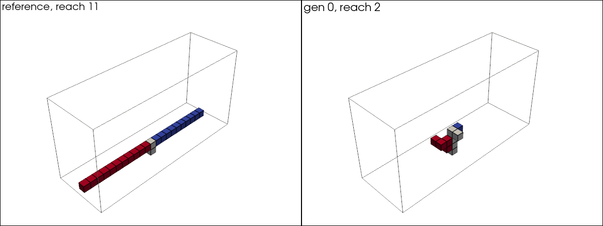
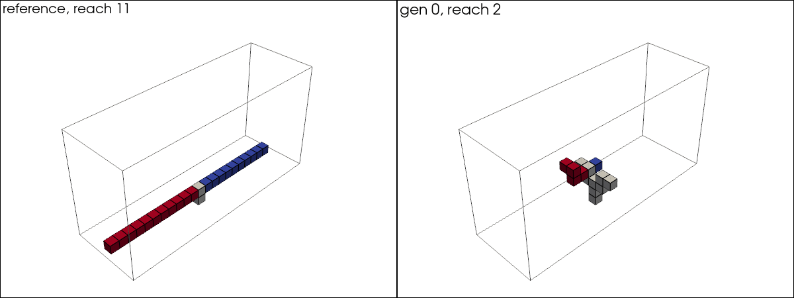
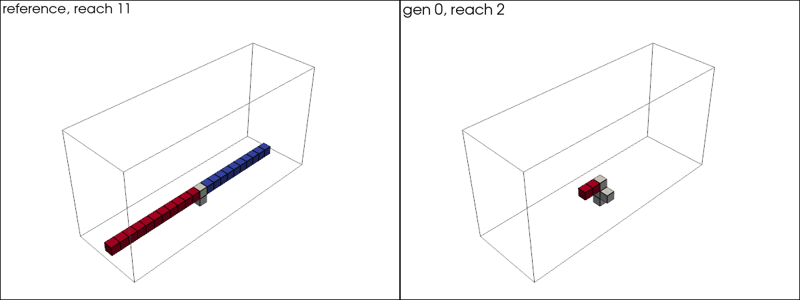
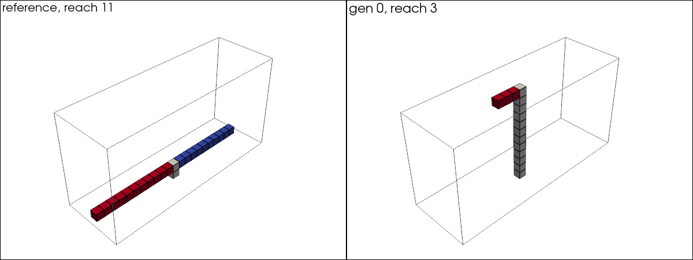
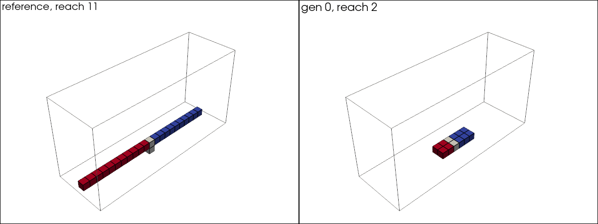

# When Does Novelty Beat the Objective?

Small neural networks build 3D structures one block at a time. The networks are
evolved, there is no backprop. The question is whether novelty search beats
plain objective search when the task is deceptive, and loses when it is not.
Two agents are compared, since the same task can be deceptive for one agent and
easy for another.

This is my working log for the project.

## Hypotheses

H1. On the bridge task, objective search stalls below what is possible. Holds
at 200 generations, where it stalls around 6 when 11 is possible. Over 2000
generations it keeps climbing slowly.

H2. On the bridge task, novelty search ends up ahead of objective search. Not
supported on 30 seeds.

H3. On the tower task, objective search does at least as well as novelty.
Holds.

H4. LocalAgent without the two lean inputs does much worse on bridge than
LocalAgent with objective search. Holds, mean reach 2.92 against 9.91.

## Setup

The grid is 24 x 8 x 12, with a base block in the middle of the floor. Each
agent gets 40 blocks. A block has to touch an existing block and sit off the
ground. The centre of mass has to stay within half a block of the base. If a
placement breaks that, the block is removed and the build ends there.

Bridge scores how far the structure reaches in +x past the base. Tower scores
height. Both top out at 11. Building straight up never shifts the centre of mass,
so tower is easy and bridge is the deceptive one.

The first agent is an MLP that takes the whole grid and scores every cell, then
places the highest legal one. It has about 590K weights. A random agent that
places anywhere legal is the baseline.

The second agent, LocalAgent, scores each legal cell on its own with one small
network shared by all cells. Its input is 12 numbers about that cell: which of
its 6 neighbours are filled, its position relative to the base, how far the
structure leans in x and y, and how many blocks are used. It has 225 weights.
LocalAgentNoCOM is the same agent without the two lean inputs, with 10 inputs
and 193 weights. Each input connects to all 16 hidden units, which is why
dropping two removes 32 weights.

Sigma is set so a mutation is about 10% of a starting weight for both agents,
0.002 for the MLP and 0.03 for LocalAgent.

There are four arms. Random, objective (selects on reach), novelty (selects on
how different a structure is from past ones), and blend (half each, both scaled
to 0 to 1 first). Each generation the top half survive and are copied with small
random changes to their weights. The best agent by the arm's own score is also
kept unchanged, so only objective's best reach per generation can never drop.

Novelty compares structures using five numbers each: block count, height, height
of the centre of mass, distance of the furthest block from the base, and average
distance from the base. An archive keeps structures that were novel enough, so
revisiting old ones earns nothing. A second version, used by the noveltysplit and
blendsplit arms, splits the furthest distance into reach in front of the base and
reach behind it, so six numbers.

Arms are compared on the task score, mainly the population mean.

## Results

Bridge task, population 50, 200 generations. Objective, blend and novelty have
30 seeds, random has 10. Each run is saved as json in runs/ and analysis.ipynb
computes everything below. The stats are two-sided permutation tests on Cliff's
delta with 10000 shuffles, which is the same test as Mann-Whitney U.

The hand built reference bridge reaches 11 using 23 of the 40 blocks.

Best reach per seed:

objective 6 5 3 6 7 2 7 6 6 8 5 5 6 3 6 8 2 7 6 5 8 5 5 6 5 4 5 2 6 5, median 5.5
blend 6 5 6 5 7 7 9 8 6 7 7 7 7 5 8 8 7 5 6 6 6 7 7 6 6 5 5 6 6 6, median 6
novelty 6 5 5 5 6 6 6 6 6 5 6 7 5 6 6 6 5 6 6 6 7 6 6 7 5 5 8 5 5 5, median 6
random 6 7 5 6 6 6 5 5 7 5, median 6

Mean reach over the last 50 generations, median across seeds: blend 3.60,
objective 3.59, novelty 1.97, random 1.02.

On best reach blend is ahead of objective, delta 0.38 and p = 0.008, and ahead
of novelty, delta 0.34 and p = 0.018. Novelty and objective are level, p = 0.33,
and so are objective and random, p = 0.51.

On mean reach blend and objective are level, p = 0.93. Both are well above
novelty and random, p < 0.001.

Objective collapses on 6 of 30 seeds and ends at 4 or below. Five of them find
their best in the first 10 generations and never improve. Blend never ends below
5, and reaches 7 or more on 13 seeds against 6 for objective. On 10 seeds blend's
lead on best reach was not significant, p = 0.33.

Novelty and blend were rerun with the split summary, 30 seeds each.

noveltysplit 6 5 5 6 6 6 6 6 5 5 6 5 7 6 7 6 6 6 5 6 7 6 5 6 5 5 5 6 6 6, median 6
blendsplit 6 6 7 6 5 6 6 7 8 9 7 6 7 6 7 7 7 7 7 6 5 8 6 8 6 8 5 6 7 7, median 7

Mean reach over the last 50 generations, median across seeds: blendsplit 3.70,
noveltysplit 2.07.

Noveltysplit and novelty are level on best reach, p = 1.0, and on mean reach,
p = 0.22. Blendsplit and blend are level on best reach, p = 0.35. Blendsplit is
ahead of objective on best reach, delta 0.49 and p = 0.001, and level on mean
reach, p = 0.65.

The split summary was tried because the counterweights in the best structures
sit much closer to the base than in the reference, 1.7 to 1.9 blocks behind on
average against 5.5, so far counterweights looked like the missing step. With
it the archive grows larger, median 306 entries against 241, but the best
structures still reach only about 3.5 behind the base.

That explanation was wrong. A simple builder that extends the bridge and adds a
counterweight only when balance needs one reaches 11 with counterweights at most
3 behind the base in 31 blocks, and at most 2 behind in 38. Close counterweights
are enough.

What stops the agents is running out of blocks. Many best structures use 38 or
more of the 41 blocks, counting the base: 13 of 30 seeds for objective, 26 of 30
for blend. They put a median of 7.5 to 12 blocks on top of the base, where they
do nothing for reach or balance, and their arm costs 2.2 to 2.6 blocks per step
of reach where 1 is enough.

So within 200 generations the limit is how well they use their blocks, and the
summary change did not help with that.

The gifs show one seed per arm, the one closest to its arm's median on best
reach first and then on mean reach. The left side is the reference bridge, the
right side is the best structure of each generation. Red blocks are in front of
the base, blue behind it and grey above it. The per generation structures come
from rerunning the same seeds with src/record.py, which matches the saved runs
exactly.

Objective seed 23. Reach 6 by generation 34, using all 40 blocks, and the
structure barely changes after that.

Novelty seed 22. The structure keeps changing shape. Reach is 5 in most
generations and drops to 3 or 4 in about a quarter of them.

Blend seed 28. The structure also keeps changing, at reach 5 for most of the
run and 6 in the last generations.

Objective and blend were rerun for 2000 generations, 5 objective seeds and 7
blend seeds. The first 200 generations match the 200 generation runs
exactly.

objectivelong 6 10 7 9 8, median 8
blendlong 8 9 8 9 9 9 10, median 9

Mean reach over the last 50 generations, median across seeds: objectivelong
6.76, blendlong 6.01.

Four of five objective seeds kept improving after generation 200, the latest at
generation 1847. Every gain was one step at a time, with no sudden jump. Seed 2
sat at 3 until generation 371 and ended at 7, so the objective collapses at 200
generations look like slow starts. Blend gained at most 2 at a time. Blend is a
little ahead on best reach and objective on mean reach. Neither difference is
significant, delta 0.34 and p = 0.38 on best reach, delta 0.43 and p = 0.27 on
mean reach, with exact permutation tests. More seeds were not run. With effects
this size about 25 seeds per arm would be needed, so these runs stay
exploratory.

Earlier bridge versions failed in two ways. On a 12 x 12 x 12 grid a random
network could already reach the maximum of 5, so evolution had nothing to
improve. With balance built into the mask, agents could never over-extend, so
the task was not deceptive and objective search reached 11.

Tower task, same settings, 10 seeds per arm.

Best height per seed:

objective 11 11 11 10 11 11 11 10 11 11, median 11
blend 11 11 11 11 11 11 11 11 11 11, median 11
novelty 10 11 11 9 11 10 11 11 11 11, median 11
random 8 9 8 8 8 10 9 8 8 8, median 8

Mean height over the last 50 generations, median across seeds: blend 8.93,
objective 8.66, novelty 5.47, random 2.21.

On best height objective and novelty are level, p = 0.72. On mean height
objective is well above novelty, p < 0.001 and Cliff's delta 0.96. Blend and
objective are level on both. Objective beats random on best height, p < 0.001,
which it does not manage on bridge.

Novelty's mean is about half of objective's on bridge and two thirds on tower.
It is behind on both tasks, so making the task deceptive did not change which
one wins.

LocalAgent on bridge, 200 generations, 30 seeds per arm.

objectivelocal 11 on all 30 seeds
blendlocal 11 on all 30 seeds
noveltylocal 11 on 27 seeds, the other three end at 7, 4 and 7

Median generation where 11 was first reached: objective 7.5, blend 10.5,
novelty 12. On seeds 7, 8, 9 and 26 a network in the starting population
already built it.

Mean reach over the last 50 generations, median across seeds: objectivelocal
9.79, blendlocal 9.45, noveltylocal 5.24.

On mean reach objective is above novelty on every seed, delta 1.0 and p < 0.001.
Blend is below objective, delta -0.74 and p < 0.001. On best reach the three
arms are level, since nearly every seed hits 11. Objectivelocal beats the MLP
objective arm on both best and mean reach, p < 0.001.

Most best structures are a flat bridge one block above the ground, using 23 to
41 blocks. The rest are a column up to the top with a beam across the whole
grid, which is allowed because balance is only a centre of mass check.

So with LocalAgent bridge stops being deceptive and looks like the tower task.
Objective wins, and the novelty half of blend only slows it down. Novelty did
not win with either agent.

Objectivelocal seed 20. The run starts from a column with reach 3 and ends on
the same bridge as the reference.

LocalAgentNoCOM on bridge, objective, 200 generations, 10 seeds.

objectivenolean 8 4 6 6 9 6 8 7 6 11, median 6.5

Only seed 9 reached 11, at generation 100. Mean reach over the last 50
generations, median across seeds: 2.92, against 9.91 for objectivelocal on the
same seeds.

Against objectivelocal it is behind on best reach, delta -0.90, and on mean
reach, delta -1.0, both p < 0.001. Against the MLP objective arm it is level on
mean reach, p = 0.31, and a little ahead on best reach, delta 0.51 and p = 0.014.

So most of what LocalAgent gains comes from seeing the lean. Without it the
shared network does about as well as the MLP on the population mean.

Objectivenolean seed 2. By generation 50 it builds a column of about 10 blocks
on the base with an arm of 6, and it keeps that structure to the end.

## Info Collected

1) sigma has to be small. The starting weights are around 0.01 to 0.05, so a
sigma of 0.1 turned every child into a new random network. 0.002 works.
2) Compare the population mean. The best ever mostly reflects how many
structures were tried.
3) If the final best equals the generation 0 best, the search is doing nothing.
A run with no mutation checks this.
4) The wrong move has to be possible, or the task is not deceptive.
5) A 100 generation run takes 45 seconds now that valid moves are only checked
next to existing blocks.

## To do

The paper compares search method and agent together. The plan is fixed here so
it does not keep growing.
* maybe change gifs to select random structure from gen best with highest score for a more interactive gif

1) for paper The still figure for it is in stills/
2) Cut readme down to short summary once the paper is done

Left for future work: a blend weight that changes during a run, other behaviour
summaries, other tasks, real physics, novelty with an elite kept by reach,
MAP-Elites.

## Limitations

1) Balance is only a centre of mass check, so a beam on a single column counts as
balanced.
2) A collapse keeps the blocks placed before it, and those still score.
3) Scores are whole numbers, so many ties.
4) Results depend a lot on the starting population.
5) About 590K weights is a lot to evolve with 50 agents.
6) Two behaviour summaries, both close variants. A different kind might behave
differently.
7) Most runs are 200 generations. The 2000 generation runs were still climbing
at the end, so where the arms would level off is not known.
8) The novelty settings (k, archive threshold) were not tuned.

## References

- Lehman & Stanley (2011). Abandoning Objectives. Evolutionary Computation 19(2).
- Goldberg (1987). Simple genetic algorithms and the minimal, deceptive problem.
- Mouret & Clune (2015). Illuminating search spaces by mapping elites.
- Pugh, Soros & Stanley (2016). Quality Diversity. Frontiers in Robotics and AI.
- Stanley & Lehman (2015). Why Greatness Cannot Be Planned.
- Gomes, Mariano & Christensen (2015). Devising Effective Novelty Search
  Algorithms. GECCO.
- Kistemaker & Whiteson (2011). Critical Factors in the Performance of Novelty
  Search. GECCO.
- Lehman & Stanley (2008). Exploiting Open-Endedness to Solve Problems Through
  the Search for Novelty. ALIFE XI.
- Cuccu & Gomez (2011). When Novelty Is Not Enough. EvoApplications.
- Such et al. (2017). Deep Neuroevolution: Genetic Algorithms Are a Competitive
  Alternative for Training Deep Neural Networks for Reinforcement Learning.
- Conti et al. (2018). Improving Exploration in Evolution Strategies for Deep
  Reinforcement Learning via a Population of Novelty-Seeking Agents. NeurIPS.
- Mordvintsev et al. (2020). Growing Neural Cellular Automata. Distill.
- Grbic et al. (2021). EvoCraft: A New Challenge for Open-Endedness.
- Sudhakaran et al. (2021). Growing 3D Artefacts and Functional Machines with
  Neural Cellular Automata. ALIFE.
- Cliff (1993). Dominance Statistics: Ordinal Analyses to Answer Ordinal
  Questions. Psychological Bulletin.
